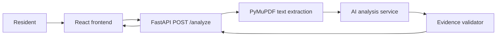
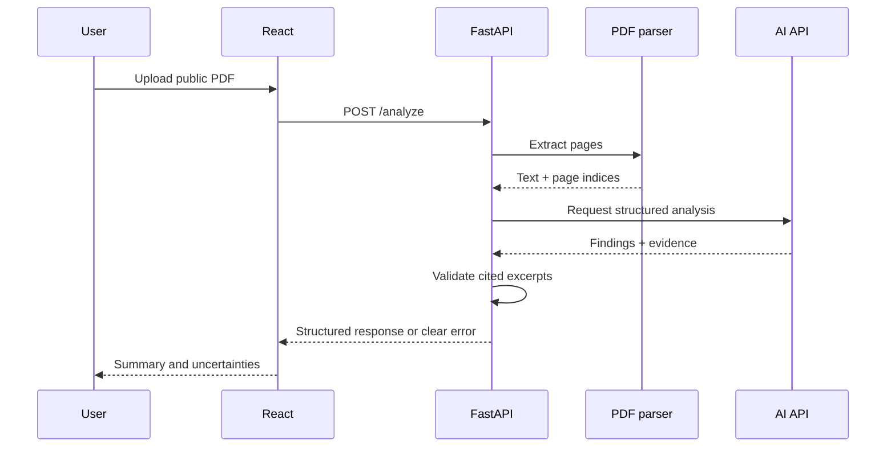

# Architecture and design decisions

## Component flow (simplified component diagram)

## Data contract

DecisionAnalysis includes document_title, summary, proposed_changes, affected_groups, potential_benefits, potential_tradeoffs, participation, and unknowns. Findings use page-numbered exact excerpts.

## Trade-offs

- **Text PDFs first:** fewer moving parts than OCR, but excludes scanned documents.
- **Page quotes over AI prose alone:** provides auditability, but exact quotes do not guarantee correct interpretation.
- **No database:** speeds MVP development, but there is no history or search functionality.
- **Server-side API key:** avoids shipping secrets to browsers.
- **Municipality-agnostic fields:** makes the same pipeline usable with different city documents without writing one-off policy logic.

## Scaling later

Add ingestion adapters per city (official agenda/PDF URLs), a document store, human review, scheduled refreshes, and filtering by region. Validate policy-specific claims against authoritative sources before publication.

## Sequence (analysis request)

